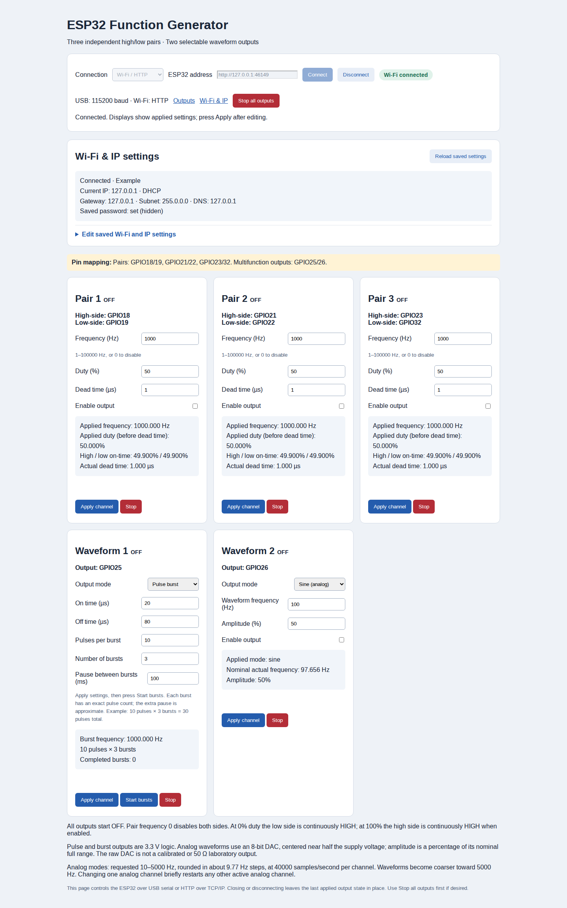

# ESP32 Function Generator

A five-channel hardware function generator for the **classic ESP32**, controlled through Wi-Fi, a standalone USB browser page, or a Python desktop application. Three complementary PWM pairs provide adjustable duty and dead time; two multifunction outputs provide pulses, finite bursts, and DAC waveforms.

This is experimental signal-generation firmware. See the electrical limits and measurement coverage below before using it with other hardware.



*Homepage preview with example device data and all outputs OFF. The controls show frequency, duty, dead time, burst timing/counts, analog frequency/amplitude, Wi-Fi settings and Stop All. Each multifunction output also supports continuous pulse, sine, triangle and rectangle modes through its mode selector.*

## What the program does

The firmware turns an ESP32 development board into a configurable signal source for electronics experiments, circuit testing and generating control or trigger signals. A computer sets the output parameters; ESP32 hardware peripherals generate the waveforms. Three paired channels and two single-pin channels use eight output GPIOs in total.

| Capability | Available settings and behavior |
| --- | --- |
| Three complementary PWM pairs | Independent frequency from 1 Hz to 100 kHz, duty from 0–100%, and dead time from 0–1000 µs where pulse widths allow it. Each pair has a high and complementary low output. |
| Two continuous pulse outputs | Independently set HIGH and LOW durations from 1–30000 µs each, with 1 µs timing resolution. |
| Two finite pulse-burst outputs | 1–255 pulses per burst, 1–1000 bursts, and an extra pause of 0–60000 ms between bursts. Pulse timing is hardware generated; the extra pause depends on main-loop scheduling. |
| Two analog waveform outputs | Choose sine, triangle or rectangle using the built-in 8-bit DACs. Request 10–5000 Hz and 0–100% amplitude; actual frequency is quantized in approximately 9.765625 Hz steps. |
| Concurrent operation | Configure each channel separately. Each multifunction pin uses one mode at a time. The two DAC channels share playback hardware, so changing one active analog output briefly restarts the other. |
| Three controller options | Wi-Fi page served by the ESP32, standalone USB browser controller, or Python desktop application. USB control works without Wi-Fi. |
| Saved network setup | Configure SSID/password and DHCP or static IP over USB. Network settings survive power-off; waveform settings return to defaults with all outputs OFF at boot. |
| Applied-state feedback | Read applied timing and burst progress. Editing a form waits for Apply; burst generation needs an explicit Start. Per-channel Stop and Stop All are available. |

The analog outputs are nominally 0–3.3 V and centered near half the supply voltage; amplitude adjusts the excursion around that center. They do not generate negative voltages. These are unbuffered, uncalibrated outputs. The project is useful as an experimental signal source, with scope verification needed for the intended load and timing. The desktop application also offers an offline demo mode.

## Control over Wi-Fi or serial

Use the ESP32 homepage at `http://<device-IP>/`, open [function-generator.html](function-generator.html) locally and choose **Wi-Fi / HTTP** or **USB serial**, or use Python. The desktop GUI accepts a serial port or an `http://` device address. All clients share command paths, parameter names and response data; Wi-Fi uses HTTP over TCP/IP.

```bash
python3 examples/control_wifi_example.py 192.168.1.50
python3 examples/control_serial_example.py /dev/ttyUSB0
```

The serial example requires `pyserial`; the Wi-Fi example uses only Python's standard library. Both read state by default. Add `--run` for a two-second Pair 1 PWM demonstration followed by Stop All. See the [unified API and examples](docs/CONTROL_API.md) for the full command reference.

The updated firmware uses the same generated interface as the local HTML page. Include `web_page.h` when building/uploading; regenerate all page outputs with `python3 web/build_standalone.py` after web source changes.

## Documentation

- [Getting started and building](docs/GETTING_STARTED.md): hardware, flashing, USB and Wi-Fi setup.
- [Code architecture](docs/ARCHITECTURE.md): file map, hardware engines, request flow and extension points.
- [GitHub release guide](docs/RELEASING.md): publication commands and release checklist.
- [License and dependencies](docs/LICENSING.md): MIT terms and third-party dependencies.
- [Desktop controller](desktop/README.md) and [browser controller](web/README.md).

**License:** [MIT](LICENSE). The project’s original code and documentation may be used, modified and redistributed, including commercially, under its terms. Third-party dependencies retain their own licenses.

## PC HTML controller over USB or Wi-Fi

Open **[function-generator.html](function-generator.html)** directly in desktop Chrome or Edge, then choose **USB serial** and click **Connect** and select the ESP32. This is a standalone HTML file with all CSS and JavaScript embedded: no server, shell script, Python, pip packages or internet connection are needed. It uses the existing web page's output cards, with USB connection and Wi-Fi/IP settings together on the same page. The browser talks directly to USB. You can copy this one file to another folder or PC.

The page reads and saves SSID, password, DHCP/static IP, gateway, subnet and DNS on the ESP32. Upload the current firmware to use the shared homepage and complete HTTP API. Close Serial Monitor and the Python GUI before connecting. See [browser controller usage](web/README.md) and [live browser checks](measurements/2026-10-15-browser-usb/README.md). The Python desktop GUI remains available as an alternative.

## Connections — updated for DAC modes

| Channel | High-side/output GPIO | Low-side GPIO |
| --- | --- | --- |
| Pair 1 | 18 | 19 |
| Pair 2 | 21 | 22 |
| Pair 3 | 23 | **32** |
| Multifunction 1 | **25** | — |
| Multifunction 2 | **26** | — |

**Pair 3's low side moved from GPIO26 to GPIO32. The second pulse output moved from GPIO27 to GPIO26.** GPIO25 and GPIO26 are the classic ESP32's DAC pins, allowing their output modes to change without external hardware. Confirm GPIO32 is free on your board and update your wiring before enabling an output.

All five channels start **OFF**. Configure Wi-Fi through either USB controller; saved settings survive normal firmware uploads. Serial at 115200 baud prints the web address and reset reason. Settings return to defaults on reboot.

## Complementary pairs

The three pairs have independently adjustable frequency (1–100000 Hz, or 0 for off), duty (0–100%), dead time (0–1000 µs subject to pulse-width limits), and enable/Stop controls. Low-side pulses are complementary. Dead time delays each output's turn-on edge, shortening both on-times without changing the period. Invalid pulse widths are rejected before applying settings.

At 0% duty the high side is LOW and the low side continuously HIGH when enabled. At 100%, the reverse applies. These constant outputs can be unsuitable for bootstrap gate drivers. Frequency 0 or disabling a pair holds **both** pins LOW.

The timer adapts from 10 MHz down to 50 kHz to represent 1 Hz with a 16-bit counter. Nonzero dead time rounds **up** to a timer tick (up to 20 µs over the supported range). At 100 kHz there are 100 ticks per period, giving 1% duty steps. The page shows the resulting timing.

## Multifunction outputs: choose one mode per output

### Continuous pulse

Each output independently sets integer on/off times of 1–30000 µs. Enable the output and press Apply. Frequency is `1000000 / (onUs + offUs)`. Timing resolution is 1 µs.

### Pulse burst

Configure:

- On time and off time: 1–30000 µs each.
- Pulses per burst: 1–255.
- Number of bursts: 1–1000.
- Extra pause between bursts: 0–60000 ms.

Press **Apply channel**, then **Start bursts**. For example, 20 µs on, 80 µs off, 10 pulses per burst and 3 bursts produces three groups of ten pulses: 30 pulses total. The final off time is part of each burst; the extra pause follows it. The output remains LOW after completion. Stop cancels the sequence immediately and returns the GPIO LOW. Progress is polled on the page without overwriting edited form fields.

A classic ESP32 has no finite hardware RMT loop counter. This implementation explicitly loads up to 255 pulse symbols plus an end marker into a 256-symbol RMT allocation. Each burst therefore fits fully in hardware memory and needs no refill while transmitting, including at 1 µs on/off times. Both outputs can burst at once using the chip's 512-symbol memory. Additional bursts are started by the main loop after the hardware completion event: their **extra pause is approximate**, including loop and Wi-Fi scheduling latency, even when set to 0 ms. Pulse timing within each burst comes from hardware.

Applying any new mode/settings to a running burst cancels that burst. Burst Apply never starts a sequence automatically.

### Sine, triangle and rectangle (analog)

These modes use the **8-bit DAC**, not PWM modulation. Each has requested frequency 10–5000 Hz and amplitude 0–100% of the nominal full DAC range. Rectangle is a 50% analog square wave with adjustable amplitude; use continuous-pulse mode for logic pulses with adjustable duty.

DAC output is nominally 0–3.3 V, depending on the supply and DAC characteristics. Waveforms are centered near half the supply voltage. Amplitude 100% uses digital codes 0–255; amplitude 0% produces a constant midscale voltage while enabled. Outputs do not swing below ground and are not calibrated or suitable as direct 50-ohm laboratory outputs. Use a buffer, reconstruction filter or AC coupling as your application requires.

Hardware DMA repeatedly plays a 4096-sample table at a nominal 40000 samples/second **per active channel**. Requested frequencies round to whole cycles per table, approximately **9.765625 Hz steps**; the page shows the nominal actual frequency. Examples: requested 50 Hz becomes 48.828125 Hz; 100 Hz becomes 97.65625 Hz. Supply/clock tolerances add further physical error. A 5000 Hz waveform has only eight samples per cycle and is much coarser than a low-frequency waveform.

Both DAC outputs may operate with different shapes, frequencies and amplitudes. They share the DAC DMA peripheral, so changing/stopping one active analog output briefly restarts the other active analog output's waveform. The three complementary pairs and a digital pulse/burst on the other multifunction output continue independently. Each multifunction output can use only one mode at a time; the driver is released when switching modes or stopping.

## Stop and verification

Stop all disconnects every digital PWM route, cancels both RMT sequences, disables/releases DAC output, and holds all eight GPIOs LOW. The stop interrupt used for MCPWM reconfiguration acknowledges a hardware timer stop; it does not synthesize signal edges. Changing a 1 Hz pair can take about one second while its timer reaches zero.

Outputs are logic/low-current analog signals, not motor power outputs. Verify the physical waveforms, duty, dead time, analog voltage and shutdown on a scope before connecting a powered inverter. Web Stop requires a working processor and network; a power stage needs its own hardware shutdown.

## Development checks

The browser JavaScript is syntax-checked. The generated DAC tables are checked for DC center, amplitude bounds, cycle count and independent-channel interleaving across sine, triangle and rectangle modes. Boot probes single/dual DAC resource allocation without enabling the DAC outputs.

For internal burst testing, `POST /burst` with `id=3` or `id=4` and `test=1` runs the RMT engine with its GPIO route disconnected and held LOW. It exercises completion, repeats and cancellation without emitting external pulses. Normal UI Start does not set this diagnostic option.

References: [MCPWM](https://docs.espressif.com/projects/esp-idf/en/stable/esp32/api-reference/peripherals/mcpwm.html), [RMT](https://docs.espressif.com/projects/esp-idf/en/release-v5.4/esp32/api-reference/peripherals/rmt.html), [DAC](https://docs.espressif.com/projects/esp-idf/en/stable/esp32/api-reference/peripherals/dac.html).

Verified on the USB-connected ESP32-D0WD-V3 using Arduino ESP32 core 3.3.12: compilation/upload, boot with all outputs disabled, all three DAC resource masks, disabled mode changes on both multifunction outputs, concurrent internal runs of three 255-pulse bursts per RMT channel, cancellation of a long burst, input-limit rejection without changing state, and return to continuous-pulse mode. Existing pair/pulse configuration tests also passed across frequency/timing limits. The external GPIO waveform and analog voltage have not been measured; analog playback has not been enabled during these remote checks. All outputs were left OFF.

## Web controls and applied values

Editing a field does not change the output until **Apply channel** is pressed. Pending edits are marked in the channel card. The pair summary shows applied frequency, applied duty before dead time, and the calculated high/low on-time percentages after dead time. These are configured timer values, not oscilloscope measurements. An OFF channel emits no waveform despite retaining its applied configuration.

Status polling waits for the previous request to finish and pauses during Apply. Requests time out and report an error instead of leaving the controls indefinitely pending. Older responses cannot overwrite a newer action. Burst Start is disabled until any edits have been applied. The page and state responses disable browser caching; existing open tabs still need a reload after firmware updates.

Browser regression checks reproduced three concurrent status requests in the previous page under slow responses and verified one in the corrected page. Apply, per-channel Stop, Stop All, mode selection, burst Apply/Start, validation feedback and stalled-request recovery were tested in Chromium. Live browser tests against the connected ESP32 verified frequency/duty updates in both device state and the displayed summary, plus both Stop controls, with external outputs disabled. Original default settings were restored and all outputs left OFF.

## Python USB GUI and saved Wi-Fi settings

Install the dependencies using the [desktop setup instructions](desktop/README.md), then run `.venv/bin/python desktop/function_generator.py`, or add `--demo` to preview it without hardware. Upload the updated sketch once to enable the serial protocol, then close Arduino Serial Monitor and connect from the app.

The desktop offers all web GUI output settings, live applied values, burst progress and Stop controls. Its **Wi-Fi & network** tab reads and sets the SSID, password, DHCP/static IP, gateway, subnet and DNS over USB. Saved network settings survive power-off in ESP32 flash; a password is kept unless explicitly replaced and is never read back. Saving reconnects Wi-Fi without rebooting or changing waveform settings. USB works even when Wi-Fi is unavailable. Output settings retain their existing boot defaults and start OFF.

See [desktop setup and usage](desktop/README.md) for installation, protocol details and checks. The waveform implementation and existing web page are unchanged. This addition compiles for the classic ESP32 with core 3.3.12 and passes 14 simulated serial/GUI tests. Live verification on the connected ESP32-D0WD-V3 also passed USB/web consistency, all output modes with external outputs disabled, internal burst tests, saved Wi-Fi/static-IP restoration across hardware resets, and the actual Python GUI workflow. Original Wi-Fi credentials and DHCP mode were restored; all outputs were left OFF. See [live USB/GUI results](measurements/2026-10-15-usb-gui/README.md). External waveforms and analog voltages were not measured during these checks.
