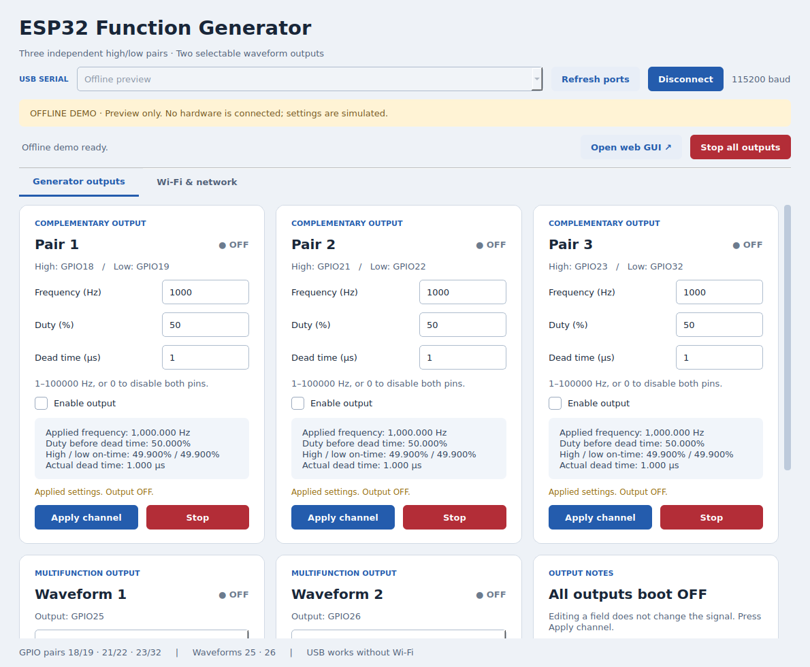
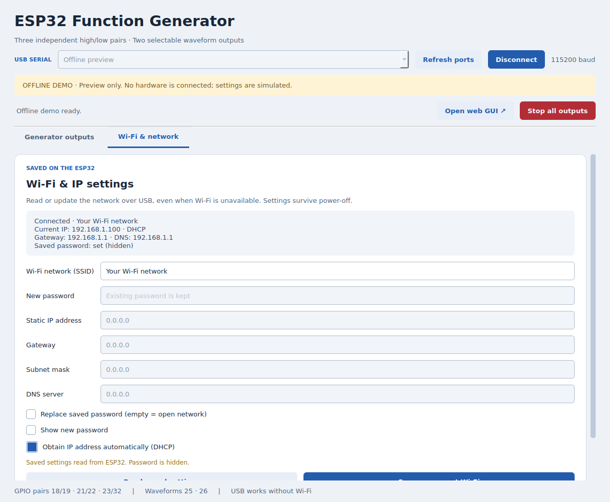

# USB and Wi-Fi desktop controller

A Qt/Python interface with the same blue, white and grey channel cards as the web GUI. It controls all five outputs through USB serial at 115200 baud or HTTP over Wi-Fi. Select a serial port or type `http://<ESP32-IP>` in the connection field.





## Start on Linux

From the sketch directory:

```bash
python3 -m venv .venv
.venv/bin/python -m pip install -r desktop/requirements.txt
.venv/bin/python desktop/function_generator.py
```

Python 3.10 or newer, the Python venv module, and internet access for the initial dependency installation are required. For an offline preview after installation:

```bash
.venv/bin/python desktop/function_generator.py --demo
```

The demo uses simulated values. It does not communicate with hardware or save settings to a board.

On Windows use `py -m venv .venv`, then `.venv\Scripts\python.exe` in place of `.venv/bin/python`. On macOS use the Linux commands above with a Python installation that supports the dependencies.

## Connect and control

1. Upload the updated `Esp32FunctionGenerator.ino` once, using the same board settings as the working sketch. No additional Arduino libraries are required: `Preferences` ships with the ESP32 core.
2. Close Arduino Serial Monitor and other programs using the serial port.
3. Start the app, select the port (or type `/dev/ttyUSB0`, `/dev/ttyACM0`, or `COM3`), and press **Connect**.
4. Read the applied settings, edit a channel, and press **Apply channel**. For burst mode, Apply first, then **Start bursts**.

The generator tab provides pair frequency/duty/dead time, continuous pulse on/off time, burst pulse count/repeats/pause, and sine/triangle/rectangle frequency/amplitude. It includes output enable, per-channel Stop, Stop All, applied timing, and burst progress. Fields have range tooltips; firmware remains the final validator for timing combinations.

The app polls device state in a background thread without overwriting pending edits. An Apply updates only its channel's form; other channel edits are preserved. Stop cancels queued Apply commands. A command already running completes before Stop can be processed. Timeouts report an unconfirmed action and never automatically repeat a mutation. Disconnecting or closing the app leaves the last applied output state in place; use Stop All first if desired. As with the web controls, USB Stop depends on a working processor.

The app keeps DTR/RTS deasserted when opening the port. Some USB drivers can still briefly toggle these lines and reset the board; a reset starts all outputs OFF. If Linux denies access to the port, check its device permissions and your serial-access group.

## Wi-Fi and IP settings

Open **Wi-Fi & network** to read:

- Saved Wi-Fi network name and whether a password is stored.
- Connection status, current IP, gateway and DNS.
- Saved DHCP/static IP configuration, including subnet mask.

To change Wi-Fi, enter the SSID. The existing password is kept unless **Replace saved password** is selected. Enter a new password, or explicitly replace it with an empty value for an open network. Passwords are hidden by default and the stored password is never sent back to the computer.

Leave DHCP checked for automatic addressing, or uncheck it and enter a static IP, gateway, subnet mask and DNS. Static host and gateway must be distinct usable addresses on the same subnet. Press **Save & reconnect Wi-Fi**. A successful acknowledgement means the settings were saved, not that the access point has accepted the connection yet. The status panel updates while Wi-Fi reconnects. USB remains available to correct settings even if the credentials are wrong or the static address is unreachable.

Credentials and addressing are stored together in ESP32 nonvolatile flash and restored on power-up. Output settings still return to their original defaults, all OFF, on reboot. The published sketch has empty Wi-Fi defaults; configure a network over USB on first use. Normal firmware uploads retain the saved network record; an erase of all flash clears it. Saving does not reboot or reconfigure waveform outputs. The desktop stores only the last serial port and window geometry, with no local password file. **Open web GUI** opens the current device address when Wi-Fi is connected.

## Serial protocol

Requests are newline-terminated UTF-8 with URL-encoded parameters:

```text
FG 1 /state
FG 2 /set?id=0&enabled=0&frequency=1000&duty=50&deadUs=1
FG 3 /network
FG 4 /stop?id=all
```

Responses use the same request ID, a status code, and a JSON payload:

```text
FG {"id":4,"code":200,"data":[...]}
```

`/set`, `/burst` and `/stop` reuse the existing web handlers and validation. `/state` returns the same channel array as the web interface. `/network` reads network state; `/network/set` accepts `ssid`, `dhcp=0|1`, `replacePassword=0|1`, optional `password`, and (for static addressing) `ip`, `gateway`, `subnet`, `dns`. Network configuration is available over HTTP and USB. Saving over HTTP can require reconnecting to a new address. The existing web page and web endpoints remain the same.

Request IDs are 1–999999999; commands are limited to 1536 bytes before the newline and 20 arguments. Errors return a non-200 code and a text payload. Boot logs do not have the `FG ` response prefix. Neither passwords nor command lines are echoed by the firmware.

## Checks

```bash
QT_QPA_PLATFORM=offscreen .venv/bin/python -m unittest discover -s tests -v
arduino-cli compile --fqbn esp32:esp32:esp32 .
```

Tests cover fragmented and stale serial replies, URL encoding of Wi-Fi credentials, errors and timeouts without replaying commands, channel validation, burst Apply/Start behavior, pending-edit preservation, static addressing, explicit password replacement, queued Stop behavior, and the threaded GUI workflow using the demo device.

Dependencies: [Qt for Python](https://doc.qt.io/qtforpython-6/) and [pySerial](https://pyserial.readthedocs.io/en/stable/pyserial_api.html).

The shared [control API](../docs/CONTROL_API.md) documents both transports and the two Python scripts in `examples/`.
