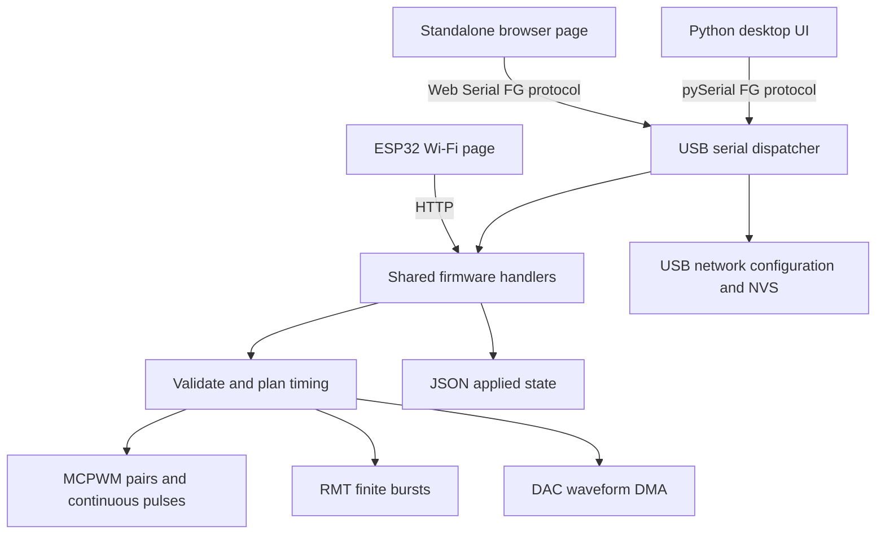

# Code architecture

## Repository map

| Path | Responsibility |
| --- | --- |
| `Esp32FunctionGenerator.ino` | Firmware, hardware drivers and shared command handlers; includes generated `web_page.h` |
| `function-generator.html` | Generated, standalone browser USB controller |
| `web/page.template.html`, `web/style.css` | Browser USB page structure and appearance |
| `web/channel-forms.js` | Browser channel forms, mode sections and summaries |
| `web/app.mjs` | Browser UI state, actions, polling and network forms |
| `web/serial.mjs` | Web Serial transport, framing, request queue and timeouts |
| `web/build_standalone.py` | Bundles shared web sources into both HTML files and `web_page.h` |
| `web/serve.py` | Optional localhost static server; USB stays in the browser |
| `desktop/function_generator.py` | Qt widgets, background worker and application entry point |
| `desktop/protocol.py` | Qt-independent serial and HTTP clients |
| `desktop/demo.py` | Simulated device for previews and GUI tests |
| `tests/` | Desktop protocol/GUI and browser transport regression tests |
| `measurements/` | Dated hardware and controller verification records |

There is no external server, database or npm build. The board owns the applied output state. Browser and desktop forms hold pending edits until Apply.

## Control flow



## Firmware data and startup

`Settings` stores requested frequency, duty, dead time, mode, pulse/burst values, amplitude and enable state. `Timing` stores the derived timer resolution, period, compare value and dead-time ticks. `Output` combines settings and timing with MCPWM handles, GPIO routing and per-channel burst state. `outputs[0..2]` are pairs; `outputs[3..4]` are multifunction channels. UI channel numbers and protocol IDs differ: Pair 1 has ID 0.

`setup()` initializes serial, calls `setupOutputs()` to allocate hardware and hold pins LOW, probes DAC resource allocation without enabling output, loads network settings and registers HTTP routes. Pair operators use MCPWM group 0; multifunction operators use group 1. A temporary seed timer establishes the group clock before per-output timers are configured.

`loop()` services burst completion, HTTP, serial and deferred Wi-Fi reconnects, then yields with a 1 ms delay. Waveform edges come from peripherals, not this loop. Repeated burst start times depend on loop scheduling.

## Three waveform engines

### MCPWM: complementary pairs and continuous pulses

`planTiming()` converts user values into representable timer ticks and rejects combinations where dead time removes a pulse. It searches timer dividers, rounds period/duty, and rounds nonzero dead time upward. Multifunction digital pulses use a 1 MHz timer, so on/off values are microseconds.

`apply()` disconnects GPIO routing while it stops/reconfigures the timer. `onStopped()` signals the hardware stop event through a semaphore. Reconfiguring a slow pair can wait until its timer reaches zero. `connect()` restores routing or sets constant 0%/100% output levels. `disconnect()` removes peripheral routing and drives the relevant pins LOW. Requested and effective timing can differ through quantization; `stateJson()` exposes applied values for UI summaries.

### RMT: finite bursts

`startBurst()` allocates a 1 MHz RMT transmitter and copy encoder. Up to 255 on/off symbols plus an end marker fit in a 256-symbol allocation, avoiding refills during a burst. Both multifunction outputs can burst concurrently using the classic ESP32's 512-symbol memory.

`onBurstDone()` sets a completion flag. `serviceBursts()` handles counts, completion and scheduling the next burst after `gapMs`. The final off interval belongs to each burst; the extra gap follows it. The gap includes main-loop latency. `stopBurst()` releases burst resources. Applying burst settings cancels an existing run but does not start another: `/burst` explicitly starts it. Diagnostic `test=1` keeps the external GPIO disconnected and LOW.

### DAC: analog sine, triangle and rectangle

`buildWaveBuffer()` creates 4096 unsigned 8-bit samples per active channel, centered at code 127.5. An integer number of cycles makes the repeating table seamless. Requested frequency rounds to `round(waveHz * 4096 / 40000) * 40000 / 4096`, giving approximately 9.765625 Hz steps.

`makeDacConfig()` and `refreshDac()` allocate and start cyclic DMA. With two active DACs, the buffer interleaves their samples and the peripheral runs at twice the per-channel 40 ksample/s rate. Both channels share one DAC resource; changing either active analog channel rebuilds playback and briefly restarts the other. Allocation/playback errors disable analog outputs and disconnect their pins. `applyMultifunction()` coordinates mode changes and resource release so one pin has only one active engine.

## Requests, validation and state

`requestHasArg()`, `requestArg()` and `respond()` adapt HTTP and serial to the same handlers. `handleSet()` parses into a temporary copy, validates ranges and timing, then applies it. Input rejection leaves the applied settings unchanged; a hardware failure may disable affected outputs. `handleStop()` disconnects pins, cancels bursts and releases DAC resources. Stop All holds all eight output GPIOs LOW.

| Route | HTTP | USB | Purpose |
| --- | --- | --- | --- |
| `/` | GET | — | Embedded Wi-Fi page |
| `/state` | GET | Yes | Applied channel array |
| `/set` | POST | Yes | Apply one channel |
| `/burst` | POST | Yes | Start configured burst |
| `/stop` | POST | Yes | Stop `id=0..4` or `id=all` |
| `/network` | GET | Yes | Read network state without password |
| `/network/set` | POST | Yes | Validate, persist and reconnect Wi-Fi |

`serviceSerial()` bounds work to 256 incoming bytes per loop and frames newline-terminated commands. `dispatchSerial()` validates IDs and URL-encoded arguments before dispatch. Requests have at most 1536 bytes before newline and 20 arguments. Boot logs are ignored by clients because they lack the `FG ` prefix.

```text
FG 1 /state
FG 2 /set?id=0&enabled=0&frequency=1000&duty=50&deadUs=1
FG 3 /stop?id=all
```

The reply envelope is `FG {"id":3,"code":200,"data":[...]}` followed by newline. Errors use non-200 codes and a string payload. The [desktop guide](../desktop/README.md#serial-protocol) lists network parameters. Channel parameter names and limits are defined in `handleSet()`; disabled burst Apply requires `enabled=0`.

`NetworkSettings` is a versioned record stored through Preferences under namespace `fg-network`, key `settings`. Output settings are not persisted. Network Save acknowledges storage before the main loop reconnects. Passwords are not returned or echoed, but the NVS record is not encrypted by this application.

## Desktop and browser internals

The desktop `SerialClient` encodes requests, buffers partial lines, matches response IDs, ignores boot/stale replies and raises device errors or timeouts. `DeviceWorker` runs blocking serial I/O in a Qt thread and serializes queued commands. `ChannelCard`, `NetworkCard` and `Window` handle forms and applied-state rendering. Stop removes older queued work; it cannot preempt a command already executing. The demo implements the client interface without hardware.

The browser `SerialTransport` performs the same framing over Web Serial with one active request, a queue, streaming UTF-8 decoding and ID matching. `app.mjs` connects it to forms and periodic polling. Both clients preserve pending edits and avoid automatically replaying timed-out mutations: a timeout does not establish whether a command was applied.

The Wi-Fi homepage and local HTML now use the same source. `web/build_standalone.py` generates `web_page.h` for the firmware and both standalone HTML files. The device header sets a flag to auto-connect to the homepage origin; local pages offer a USB/HTTP choice. `web/http.mjs` and `web/serial.mjs` implement the same request contract, including queuing and Stop priority. The Python `HttpClient` and `SerialClient` expose that contract too. See [CONTROL_API.md](CONTROL_API.md).

## Building, testing and extending

Run `python3 web/build_standalone.py` after browser source edits and commit both generated HTML files and `web_page.h`. Use the build and test commands in the [release guide](RELEASING.md). Desktop/browser regression tests use simulated devices and streams; scope verification is required for physical timing and analog accuracy.

To add a setting or mode, update `Settings`, firmware validation, engine/resource transitions and `stateJson()`, then update desktop fields/demo and both web interfaces. Extend tests around behavior such as validation, pending edits or command ordering. To change pins, update `setupOutputs()` and the wiring documentation; analog outputs require the real DAC pins. Keep interrupt callbacks short and schedule repeated work in the main loop.
